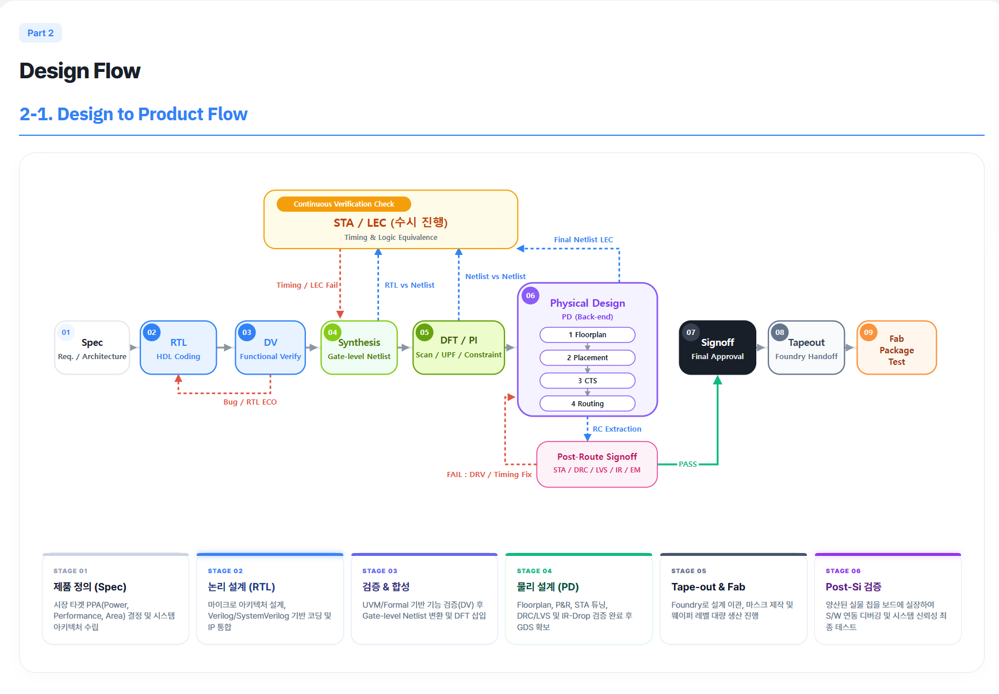

# 📘 ChipBook

## 📝 프로젝트 개요

디지털 회로설계와 반도체 시스템 학습 내용을 주제별로 정리한 웹 가이드북입니다. 학습 페이지, 도식과 문제 풀이를 한 곳에서 탐색할 수 있도록 구성했습니다.

**기술**: `HTML` · `CSS` · `JavaScript` · `GitHub Pages`

## 🔑 주요 구성

- **🧭 설계 흐름**: 제품 사양부터 RTL, 검증·합성, 물리 설계, Signoff와 Tape-out까지 단계별 정리
- **💾 메모리 동작**: SRAM·DRAM의 읽기·쓰기·Refresh 비교, NAND의 Program·Read·Erase 동작 시각화
- **🧩 소자 구조**: Planar MOSFET과 FinFET의 3D 구조 및 단면 비교
- **✅ 검증·인터페이스**: UVM 검증 구조, On-Chip Bus와 Off-Chip Interface 학습
- **📝 개념 복습**: AI Accelerator를 포함한 주제별 설명과 예상·모의 문제

## 🖼️ 대표 화면

각 화면 이름을 누르면 원본 크기로 확인할 수 있습니다.

| 화면 | 확인할 수 있는 내용 |
|---|---|
| [📚 전체 목차](./docs/images/table-of-contents.png) | 설계·검증·메모리·인터페이스 학습 주제와 문제 풀이 구성 |
| [🧭 설계 흐름](./docs/images/design-flow.png) | 설계 단계의 연결과 STA·LEC·물리 검증 흐름 |
| [💾 SRAM·DRAM](./docs/images/sram-dram.png) | 셀 구조, 읽기·쓰기·Refresh 동작, 특성 비교 |
| [🧩 MOSFET 3D](./docs/images/mosfet-3d.png) | Planar MOSFET·FinFET의 게이트와 채널 구조 비교 |
| [✅ UVM 검증](./docs/images/uvm-verification.png) | 테스트벤치 구조와 UVM의 재사용성·계층 구조·검증 목적 |
| [⚡ NAND Flash](./docs/images/nand-flash.png) | Program·Read·Erase 동작과 Flash에서 SSD로 이어지는 구성 |

## 📂 바로 보기

- **[🌐 웹페이지 열기](https://bujh99.github.io/ChipBook/)**
- **[💻 원본 코드와 로컬 실행 안내](https://github.com/BUJH99/ChipBook)**

포트폴리오에는 대표 화면과 소개를 두고, 웹앱 코드는 원본 저장소에서 관리합니다.
