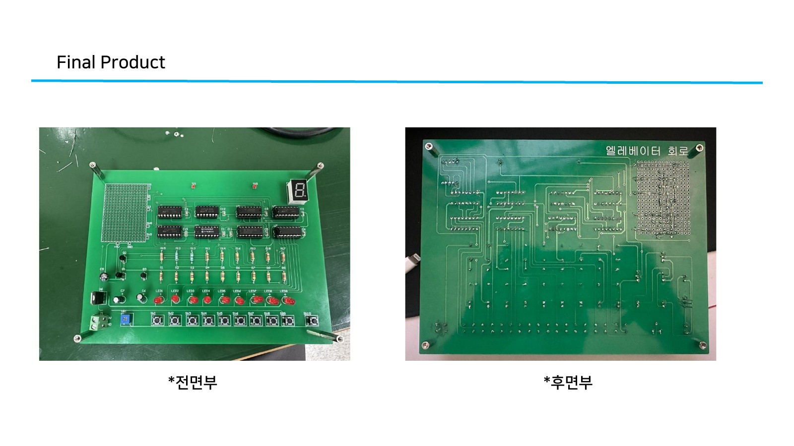

# 📟 엘리베이터 제어 회로·PCB 제작

## 📅 프로젝트 정보

- **수행**: 2025.07 · 나인ES캠퍼스 실습
- **작업**: 회로 분석·시뮬레이션, PCB Artwork, 배선·실장과 측정 확인
- **도구**: `OrCAD Capture` · `PCB Editor` · `Discrete Logic`

## 📝 프로젝트 개요

Discrete Logic 기반 엘리베이터 제어 회로를 분석하고, 시뮬레이션·PCB Artwork·실물 배선·측정으로 이어지는 하드웨어 실습을 수행했습니다. 버튼으로 선택한 목표 층을 저장하고 현재 층과 비교해 상승·하강을 제어하며, LED와 7-Segment로 현재 층을 표시하는 구조입니다.

보고서의 동작 요구사항은 **1~9층 선택**, **Reset 시 1층 표시**, **목표 층에 따른 Up/Down 카운트**입니다. PCB 실습에서는 다이오드·테스트포인트 회로의 배치·배선과 실제 기판 구현을 다뤘습니다.

## 🖼️ 제작 기판

실습 보고서 19쪽의 완성 기판 사진입니다. 전면의 제어 IC·버튼·LED·7-Segment와 후면 배선을 확인할 수 있습니다.

## 🔑 주요 구현

### 🧩 제어 회로 구성

| 블록 | 주요 소자 | 역할 |
|---|---|---|
| 입력 인코딩 | `CD4532B` | 버튼 입력을 코드로 변환하고 래치 제어용 GS 신호 출력 |
| 목표 층 저장 | `CD4042A` | 인코더 출력 값을 저장하고 유지 |
| 현재·목표 층 비교 | `74HC85` | 두 값을 비교해 상승·하강 제어에 사용할 신호 생성 |
| 층수 카운트 | `CD4516B` | 비교 결과와 클럭에 따라 현재 층 카운트 갱신 |
| 클럭 생성·분주 | Multivibrator · `CD4518B` | 펄스 생성과 1/100 분주 회로 구성 |
| 층수 표시 | `74HC42` · `74LS47` | LED 및 7-Segment 표시용 디코딩 |

### 🛠️ PCB Artwork·실물 구현

- 다이오드와 테스트포인트 회로를 PCB Editor에서 배치·배선
- Bottom 배선 도면을 좌우 반전해 실제 기판의 배선 방향 확인
- 부품 실장과 배선 후 기판 전면·후면 및 테스트포인트 파형 기록

## 🔬 시뮬레이션·측정

| 확인 항목 | 보고서에 수록된 결과 | 페이지 |
|---|---|---|
| 발진 회로 | 50 ms Transient 해석과 트랜지스터 출력 파형 | 5~6쪽 |
| 제어 회로 | 15 ms Transient 해석과 인코더·비교기·카운터 관련 신호 파형 | 7~12쪽 |
| 다이오드 회로 | 입력·다이오드 상태에 따른 출력 전압 검토와 구현 회로 | 14~16쪽 |
| 기판 제작 | PCB Layout, 실물 배선, 완성 기판 전면·후면 | 17~19쪽 |
| 테스트포인트 | TP1·TP2 오실로스코프 파형 사진 | 20쪽 |

## 📂 보고서에서 바로 찾기

**[📄 실습 보고서 전체 보기](<./Report/PCB Artwork 실습_한정호.pdf>)** · 총 20쪽

- **3~4쪽**: 전체 블록도와 동작 요구사항
- **5~12쪽**: 발진·제어 회로와 시뮬레이션
- **13~16쪽**: 출력·표시 회로, 다이오드·테스트포인트 회로
- **17~19쪽**: PCB Layout과 실물 제작 결과
- **20쪽**: TP1·TP2 측정 사진

포트폴리오에는 실습 보고서와 기판 미리보기를 수록했습니다. 회로도와 시뮬레이션 파형은 보고서에서 확인할 수 있습니다.
