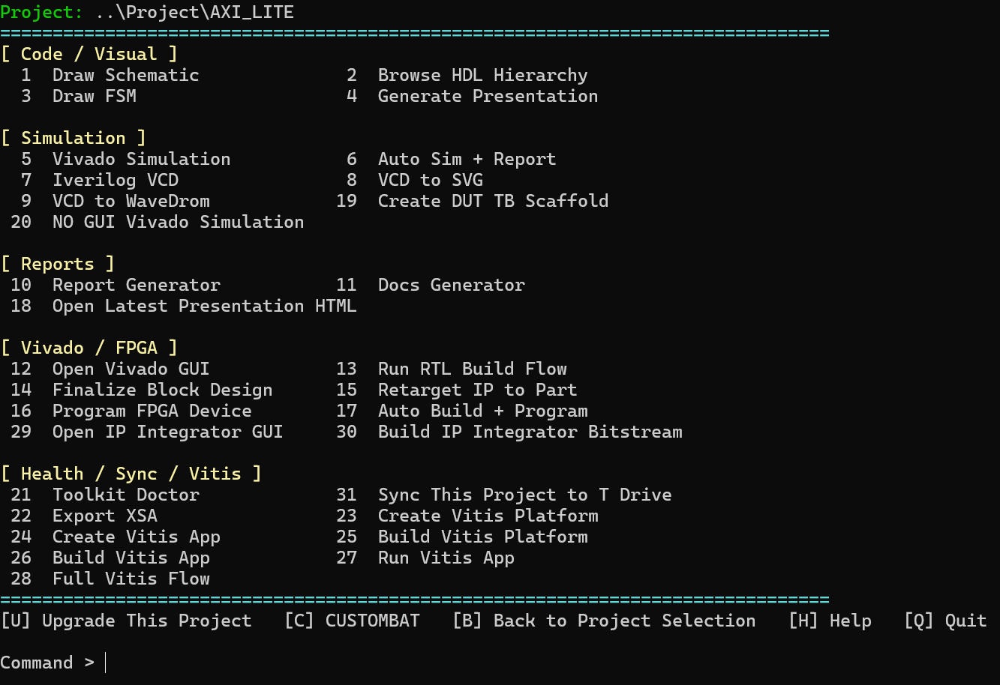

# 🛠️ FPGAClaw · FPGA Automation Toolkit

## 📝 프로젝트 개요

프로젝트 선택부터 시뮬레이션·Vivado 빌드·보고서 확인까지 Windows 메뉴와 manifest로 연결한 FPGA 개발 자동화 도구입니다.

프로젝트마다 필요한 TOP, 소스, 테스트벤치, 제약 파일을 `fpga_auto.yml`로 정의하고, 공통 실행 도구를 재사용하는 구조입니다.

**구현 기술**: `BAT` · `Python` · `Tcl` · `JavaScript` · `YAML`

## 🔑 주요 구현

| 영역 | 주요 기능 |
|---|---|
| 📁 프로젝트 관리 | manifest 기반 프로젝트 검색·선택, 새 프로젝트 생성, 설정 관리 |
| 🔍 코드 분석 | HDL 계층 탐색, 회로도·FSM 시각화 |
| 🧪 시뮬레이션 | Vivado XSim·Icarus Verilog 실행, VCD 파형 변환, 자동 시뮬레이션·보고서 연결 |
| ⚙️ Vivado 빌드 | 합성·구현·bitstream 생성, FPGA 프로그래밍 메뉴 |
| 📄 결과 정리 | HTML 보고서·소스 문서·발표 자료 생성과 결과 확인 |
| 🤖 원격 작업 | Telegram에서 프로젝트 선택, 작업 실행, 상태·최근 결과 확인 |

시뮬레이션·보고서·Vivado 작업 영역을 분리하고, 공통 실행 도구와 프로젝트 설정을 공유합니다.

## 🖼️ 대표 화면

| 화면 | 확인할 수 있는 내용 |
|---|---|
| [📁 프로젝트 선택](./docs/images/project-selection.png) | 프로젝트 목록, 선택된 프로젝트와 대상 FPGA 정보 |
| [🛠️ 작업 메뉴](./docs/images/command-menu.png) | 코드 분석·시뮬레이션·보고서·Vivado 작업 진입점 |
| [❓ 도움말](./docs/images/help.png) | 화면별 단축키와 기본 사용 순서 |
| [📱 Telegram 연동](./docs/images/telegram-remote.png) | 모바일 명령과 프로젝트·상태·최근 결과 조회 메뉴 |

## ⚙️ 프로젝트 설정 예제

[📄 fpga_auto.yml 예제](./examples/fpga_auto.yml)는 프로젝트 설정 구조를 보여줍니다.

| 설정 | 용도 |
|---|---|
| `project.name` | 프로젝트 이름 |
| `hdl.top` | 설계 최상위 모듈 |
| `hdl.src_globs` · `hdl.tb_globs` | RTL 소스와 테스트벤치 검색 패턴 |
| `hdl.inc_globs` · `hdl.xdc_globs` · `hdl.exclude_globs` | include·제약 파일 검색 및 제외 패턴 |
| `sim` | 시뮬레이터와 timescale 설정 |
| `vivado` | 대상 FPGA part와 빌드 strategy |
| `report` | 보고서 생성 여부와 형식 |

사용할 때는 예제 파일을 대상 프로젝트 루트에 두고 TOP 이름, 파일 경로, FPGA part를 실제 설계에 맞춥니다. 실행에는 원본 툴킷과 대상 프로젝트의 HDL 소스·테스트벤치가 필요합니다.

## 📂 코드와 자료

- **[💻 원본 저장소·설치 및 실행 안내](https://github.com/BUJH99/FPGA_Auto_Project)**
- **[📄 프로젝트 설정 예제](./examples/fpga_auto.yml)**

이 폴더는 소개·설정 예시·화면 자료를 제공하며, 실행 프레임워크는 원본 저장소에서 관리합니다.
