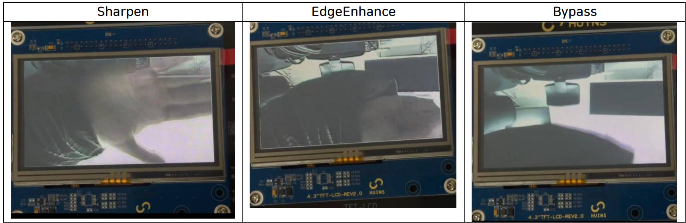

# 🖼️ FPGA 영상 필터링 · Line Buffer 개선

## 📅 프로젝트 정보

- **수행**: 2025.10 ~ 2025.12
- **하드웨어**: Ultra96-V2 · Zynq UltraScale+ ZU3EG · OV5640 카메라 · 4.3인치 TFT-LCD
- **본인 담당**: TOP 통합, 픽셀 포맷 변환, 클럭 생성, 테스트벤치, 카메라 I2C 통합
- **기술**: `SystemVerilog` · `C` · `BRAM` · `Vivado / XSim 2025.2`

## 📝 프로젝트 개요

OV5640 카메라의 480×272 영상을 FPGA에서 필터링해 TFT-LCD로 출력하는 팀 프로젝트입니다. 카메라의 RGB565 데이터를 RGB888로 변환하고, 3×3 윈도우와 Convolution·ReLU 연산을 거쳐 RGB565 출력 프레임을 구성합니다.

두 줄의 Line Buffer와 가로 방향 픽셀 재사용 구조를 적용해 입력 프레임을 한 번씩 순차적으로 읽도록 설계했습니다. 3×3 윈도우를 생성하는 데 필요한 BRAM 접근을 줄이고, 윈도우 정확도와 필터 파이프라인의 처리량을 시뮬레이션으로 검증했습니다.

## 🧩 처리 구조

```text
OV5640 → RGB565 수신·패킹 → RGB888 변환 → 입력 프레임 버퍼
       → 2-Line Buffer → 3×3 Convolution·ReLU → RGB565 변환
       → 출력 프레임 버퍼 → TFT-LCD
```

| 구성 | 주요 모듈·동작 |
|---|---|
| 카메라 설정·입력 | `CamI2c`, `CamI2cCommand`, `CamI2cRom`, `CameraToRam` |
| 클럭·픽셀 변환 | `ClkDivider`, `ClockEnableGenerator`, `Rgb565ToRgb888`, `Rgb888ToRgb565` |
| 윈도우 생성 | `Window3x3LineBuffer` — 480×24-bit Line RAM 2개, 가로 방향 shift register, 경계 zero padding |
| 필터 연산 | `Conv3x3ReluParam` — RGB 채널별 3×3 가중합과 0~255 포화 처리 |
| 시스템 연결·표시 | `TOP`, `MemToTftLcd`, 입력 RGB888·출력 RGB565 프레임 버퍼 |

`iFilterMode`는 **0: Bypass · 1: Sharpen · 2: Edge Enhance · 3: Emboss**를 선택합니다. `Code/SW`의 Vitis 제어 예제는 UART 입력으로 모드 0~2를 받아 AXI 레지스터 `0xA0000000`에 기록합니다.

## ✅ 핵심 성과

**480×272 · 100 MHz 코어 시뮬레이션**에서 수평 재사용 방식의 `Window3x3Case9`와 두 줄 Line Buffer를 비교했습니다.

| 측정 항목 | 기존 윈도우 | Line Buffer |
| :--- | ---: | ---: |
| 입력 BRAM 읽기 | 390,720회 | **130,560회** |
| 출력 구간 | 1,042,968 cycles | **130,560 cycles** |
| 평균 출력 간격 | 7.988473 cycles/pixel | **1 cycle/pixel** |
| 코어 처리량 | 12.518 MPixel/s | **100.000 MPixel/s** |

입력 BRAM 읽기를 **66.7% 줄이고**, 유효 출력 구간의 처리량을 **약 7.988배 높였습니다**. Line Buffer의 130,560개 윈도우는 독립 zero-padding 참조 모델과 일치하며, 초기 채움 이후 매 클록 1픽셀을 출력합니다.

**OOC 합성 결과** — Vivado 2025.2, `xczu3eg-sbva484-1-i`, 10 ns 클럭 제약:

| 모듈 | LUT | FF | RAMB18 | DSP | 합성 후 WNS |
|---|---:|---:|---:|---:|---:|
| `Window3x3Case9` | 374 | 373 | 0 | 6 | +5.309 ns |
| `Window3x3LineBuffer` | 267 | 432 | 2 | 0 | **+8.332 ns** |
| `Conv3x3ReluParam` | 958 | 25 | 0 | 0 | +5.522 ns |

## 🧪 테스트 구성

| 테스트 | 검사·측정 내용 |
|---|---|
| 모듈 성능 테스트 1개 | Line Buffer의 모든 3×3 윈도우와 zero-padding 참조값 비교, 기존 윈도우의 BRAM 읽기·출력 간격, Convolution 입출력 개수·처리량 |
| 통합 처리량 테스트 8개 | 4개 필터 × 입력 메모리 사전 적재·카메라 스트림, 시나리오별 출력 BRAM 쓰기 130,560회와 단계별 처리량 |
| OOC 합성 | 윈도우 2종과 Convolution의 자원 사용량·합성 후 타이밍 |

시뮬레이션용 프레임 버퍼는 `tb_memory_models.v`에 정의되어 있습니다. 비교용 `TestBench/reference/Window3x3Case9.sv`는 `RasterAddrGen`과 함께 모듈 성능 테스트에 사용됩니다.

## ▶️ 실행 방법

**Windows · Python 3 · Vivado XSim** 환경에서 실행합니다. `FPGA_Image_Filtering` 폴더를 기준으로:

```powershell
$env:VIVADO_BIN = "C:\AMDDesignTools\2025.2\Vivado\bin"
python ..\tools\run_xsim.py .\Code\tests.json
```

전체 시뮬레이션은 [`tools/run_xsim.py`](../tools/run_xsim.py)와 [`Code/tests.json`](./Code/tests.json)에 정의된 9개 테스트를 실행합니다. 개별 테스트와 OOC 합성은 아래 배치 파일을 사용합니다.

```powershell
.\Code\TestBench\run_module_perf_tb.bat
.\Code\TestBench\run_perf_tb.bat 1 preload
.\Code\TestBench\run_perf_tb.bat 1 stream
.\Code\TestBench\run_ooc_timing.bat
```

`run_perf_tb.bat`의 첫 인자는 필터 모드 `0~3`, 두 번째 인자는 `preload` 또는 `stream`입니다. `run_linebuffer_ooc.bat`은 Line Buffer만 합성합니다. 시뮬레이션 결과는 `Code/results/`, 빌드와 OOC 결과는 `Code/.sim_build/`에 생성됩니다.

보드 구성은 `InputMemory_RGB888`·`OutputMemory_RGB565` BRAM IP, PS의 클럭·리셋·필터 모드 연결, Vitis BSP를 사용합니다. [`test.xdc`](./Code/Constraints/test.xdc)에 카메라와 LCD의 외부 핀 배치가 정의되어 있습니다.

## 📂 코드와 검증

- **[💻 RTL](./Code/Source)** · **[🧪 테스트벤치·실행 스크립트](./Code/TestBench)**
- **[⚙️ 테스트 구성](./Code/tests.json)** · **[📍 보드 제약](./Code/Constraints/test.xdc)** · **[🎛️ Vitis 제어 예제](./Code/SW)**
- **[📄 팀 프로젝트 보고서](./Report/고급프로젝트_HW.pdf)** — 개발 환경 4쪽, 시스템 구조 5쪽, 보드 결과 24쪽
- **[🗺️ 시스템 구성도](./Report/images/Overall%20Architecture.png)** · **[📊 기존 설계 성능표](./Report/images/Performance.png)**

## 📷 보드 동작 결과

**Sharpen · Edge Enhance · Bypass** 필터를 적용한 TFT-LCD 출력입니다.


