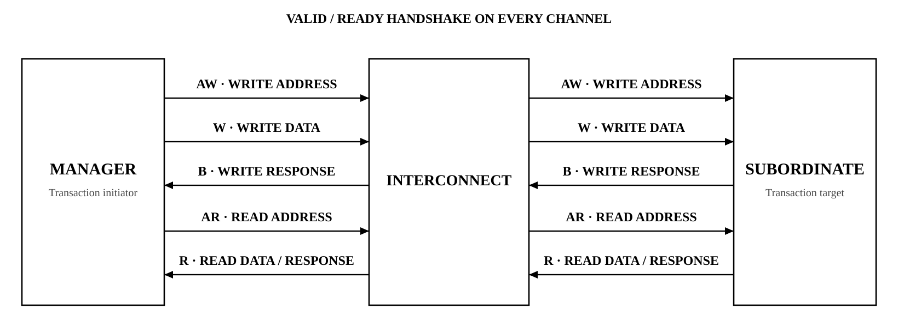

# 🔌 AXI4 세미나

## 📝 설명한 내용

- **5개 독립 채널**: AW·W·B·AR·R의 역할과 read/write transaction 흐름
- **VALID/READY**: 수락 시점, payload 유지, 채널 사이의 의존성
- **Burst와 순서**: 전송 속성, ID·응답·ordering의 관계
- **Memory attribute**: bufferable·cacheable 등 속성이 의미하는 접근 조건
- **Exclusive access**: read/write 쌍과 성공·실패 응답의 의미

## 📂 대표 도식

- [Handshake 의존성](./images/axi-handshake-dependencies.svg)
- [Memory attributes](./images/axi-memory-attributes.svg) · [Exclusive access](./images/axi-exclusive-access.png)
- [SoC AXI4-Lite–APB 적용](../../../RISC_V_SoC)

AXI4 세미나의 학습 요약과 설명 자료입니다. 세미나의 범위와 실제 SoC에서 구현한 AXI4-Lite 범위를 구분합니다.
