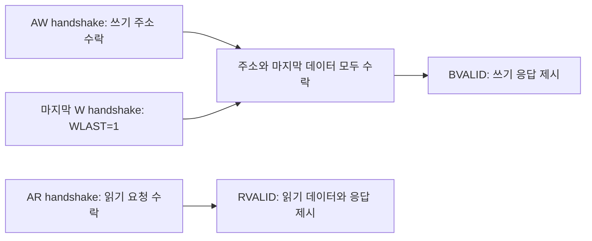

# 🔌 AXI4 세미나

## 📝 학습 범위

**AMBA AXI4**의 채널별 전송 수락, 응답 조건, 메모리 접근 속성을 정리합니다. 기준은 Arm **IHI 0022H**이며, 아래에서는 사양서의 Master·Slave 용어를 사용합니다.

## 1. 5개 독립 채널

| 채널 | payload 방향 | 역할 |
| --- | --- | --- |
| AW | Master → Slave | 쓰기 주소·전송 속성 |
| W | Master → Slave | 쓰기 데이터·byte strobe·마지막 beat |
| B | Slave → Master | 쓰기 transaction 응답 |
| AR | Master → Slave | 읽기 주소·전송 속성 |
| R | Slave → Master | 읽기 데이터·응답·마지막 beat |

각 채널의 송신 측이 VALID와 payload를, 수신 측이 READY를 구동합니다. 채널별로 독립적인 흐름 제어가 가능하며 주소와 데이터의 수락 시점이 같을 필요는 없습니다. [Arm — AXI Interface 소개](https://developer.arm.com/community/arm-community-blogs/b/soc-design-and-simulation-blog/posts/introduction-to-axi-protocol-understanding-the-axi-interface)

## 2. VALID/READY와 응답 의존성

**ACLK 상승 에지에서 VALID와 READY가 모두 1이면 한 beat가 수락됩니다.** VALID=1, READY=0 동안에는 VALID와 payload를 유지합니다. 송신 측은 READY를 기다렸다가 VALID를 올리면 안 되며, 수신 측은 VALID를 확인한 뒤 READY를 올릴 수 있습니다. [Introduction to AMBA AXI4 §4](https://developer.arm.com/-/media/Arm%20Developer%20Community/PDF/Learn%20the%20Architecture/102202_0100_01_Introduction_to_AMBA_AXI.pdf#page=17)

AW와 W는 어느 쪽이 먼저 수락되어도 됩니다. BVALID는 AW와 마지막 W 수락 이후, RVALID는 AR 수락 이후에 제시합니다. BREADY·RREADY를 기다리며 VALID를 지연해서는 안 됩니다. [Introduction to AMBA AXI4 §5.12](https://developer.arm.com/-/media/Arm%20Developer%20Community/PDF/Learn%20the%20Architecture/102202_0100_01_Introduction_to_AMBA_AXI.pdf#page=39)

## 3. Burst와 ID

`Ax`는 AR 또는 AW를 뜻합니다. beat 수는 `AxLEN + 1`, beat당 최대 바이트 수는 `2^AxSIZE`로 지정합니다.

| burst | AXI4 beat 수 | 주소 진행 |
| --- | --- | --- |
| FIXED | 1–16 | 유지 |
| INCR | 1–256 | 증가 |
| WRAP | 2·4·8·16 | 정해진 경계에서 순환 |

WRAP 시작 주소는 transfer size에 정렬합니다. `WSTRB`는 유효한 쓰기 byte를, `WLAST`·`RLAST`는 마지막 beat를 표시합니다. [Introduction to AMBA AXI4 §5](https://developer.arm.com/-/media/Arm%20Developer%20Community/PDF/Learn%20the%20Architecture/102202_0100_01_Introduction_to_AMBA_AXI.pdf#page=32)

Burst는 **4KB 경계를 넘을 수 없습니다**. [IHI 0022H §A3.4](https://developer.arm.com/-/media/Arm%20Developer%20Community/PDF/IHI0022H_amba_axi_protocol_spec.pdf#page=47)

같은 ID의 같은 방향 transaction은 응답 순서를 유지하고, 다른 ID는 완료 순서가 달라질 수 있습니다. 읽기·쓰기 사이에는 같은 ID라도 전역 순서가 생기지 않습니다. AXI4는 write data interleaving을 지원하지 않습니다. [Introduction to AMBA AXI4 §7](https://developer.arm.com/-/media/Arm%20Developer%20Community/PDF/Learn%20the%20Architecture/102202_0100_01_Introduction_to_AMBA_AXI.pdf#page=49)

## 4. Memory attribute

| 비트 | AWCACHE | ARCACHE |
| --- | --- | --- |
| [3] | Allocate | Other Allocate |
| [2] | Other Allocate | Allocate |
| [1] | Modifiable | Modifiable |
| [0] | Bufferable | Bufferable |

AXI4의 bit[1]은 **Modifiable**입니다. transaction 변경 허용과 cache 할당을 구분해야 합니다. Allocate는 할당을 권고하며 보장하지 않습니다. Other Allocate는 다른 접근으로 이미 cache에 존재할 가능성을 나타냅니다. 응답 가능 지점과 전파 조건은 Bufferable 하나가 아닌 전체 memory type 조합으로 판단합니다. [IHI 0022H §A4.3–A4.4](https://developer.arm.com/-/media/Arm%20Developer%20Community/PDF/IHI0022H_amba_axi_protocol_spec.pdf#page=65)

## 5. Exclusive access

Exclusive read 완료 후 동일한 ID·주소·필수 속성을 갖는 exclusive write를 수행합니다. 예약 상태를 검사하는 방식이며 버스 전체를 잠그는 동작은 아닙니다.

| Slave의 exclusive 지원 | 응답·메모리 반영 |
| --- | --- |
| 지원: read | EXOKAY, 예약 상태 기록 |
| 지원: write 성공 | EXOKAY, 메모리 갱신 |
| 지원: write 실패 | OKAY, 메모리 갱신 없음 |
| 미지원 | read는 OKAY, write는 일반 쓰기로 처리되어 메모리 갱신 가능 |

따라서 **OKAY만으로 exclusive write의 메모리 반영 여부를 단정하면 안 됩니다**. read 응답에서 지원 여부를 확인하고 실패 시 재시도 흐름을 설계합니다. [IHI 0022H §A7.2](https://developer.arm.com/-/media/Arm%20Developer%20Community/PDF/IHI0022H_amba_axi_protocol_spec.pdf#page=96)

## 6. AXI4-Lite와 적용 범위

AXI4-Lite는 단일 beat, 32/64-bit 데이터 버스의 제어·상태 레지스터 접근에 적합하며 burst와 exclusive access를 지원하지 않습니다. 여러 outstanding transaction은 허용하지만 구현에서 수락 수를 제한할 수 있습니다. [IHI 0022H §B1.1](https://developer.arm.com/-/media/Arm%20Developer%20Community/PDF/IHI0022H_amba_axi_protocol_spec.pdf#page=120)

[RISC-V SoC의 개인 구현](../../../RISC_V_SoC/README.md)은 AXI4-Lite–APB 연결에 해당합니다.

## 7. 검증 시나리오로 연결

다음은 학습한 규칙에서 도출한 기본 검증 항목입니다.

| 자극·상황 | 관측·검사 항목 |
| --- | --- |
| READY를 여러 cycle 낮춤 | 수락 전 VALID와 payload 안정성 |
| AW 선행 / W 선행 | 주소·마지막 데이터 수락과 BVALID의 관계 |
| burst 길이·경계 변화 | beat 수, LAST, byte strobe, 4KB 경계 |
| 같은 ID / 다른 ID 요청 혼합 | ID별 응답 매칭과 허용된 완료 순서 |
| exclusive 성공 / 예약 무효화 / 미지원 | 응답 코드와 실제 메모리 반영을 함께 비교 |

Monitor는 VALID/READY가 동시에 성립한 전송을 수집하고, Scoreboard는 채널별 관측값을 transaction으로 연결해 검사하도록 구성할 수 있습니다.

## 📂 참고 문헌

- Arm [AMBA AXI and ACE Protocol Specification — IHI 0022H](https://developer.arm.com/-/media/Arm%20Developer%20Community/PDF/IHI0022H_amba_axi_protocol_spec.pdf): §A3 전송, §A4 속성, §A5 ID·순서, §A7.2 exclusive, §B1 AXI4-Lite.
- Arm [Introduction to AMBA AXI4 — 102202, Issue 01](https://developer.arm.com/-/media/Arm%20Developer%20Community/PDF/Learn%20the%20Architecture/102202_0100_01_Introduction_to_AMBA_AXI.pdf): 채널과 handshake·burst의 입문 설명.
- [UVM 세미나](../UVM/README.md) · [인턴십 기술 세미나 목록](../../README.md)
