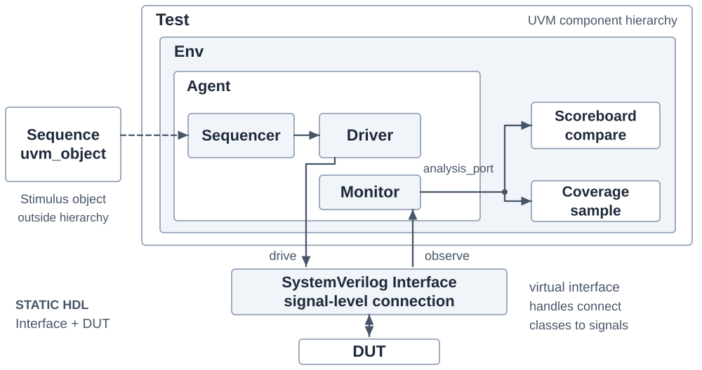

# 🧪 UVM 세미나

## 📝 설명한 내용

- **OOP와 재사용**: 상속·다형성, transaction과 component의 역할
- **검증 구조**: Test → Env → Agent와 Sequencer·Driver·Monitor 연결
- **Sequence 흐름**: item 요청·전달·완료 handshake
- **분석 경로**: Monitor가 Analysis Port로 Scoreboard·Coverage에 관측값 배포
- **라이브러리 서비스**: Factory·configuration·phase·objection의 목적

## 📂 대표 도식

- [OOP 개념](./images/uvm-oop-concepts-explained.svg) · [라이브러리 서비스](./images/uvm-library-services.svg)
- [Sequence handshake](./images/uvm-handshake.png) · [Analysis Port](./images/uvm-analysis-port.png)
- [실제 FIFO 적용](../../../UVM_FIFO) · [SPI·I2C 멀티에이전트 적용](../../../UVM_SPI_I2C)

직접 구성한 설명 도식과 요약을 공개합니다. 교재 원문과 회사 내부 발표 원본은 포함하지 않습니다.
