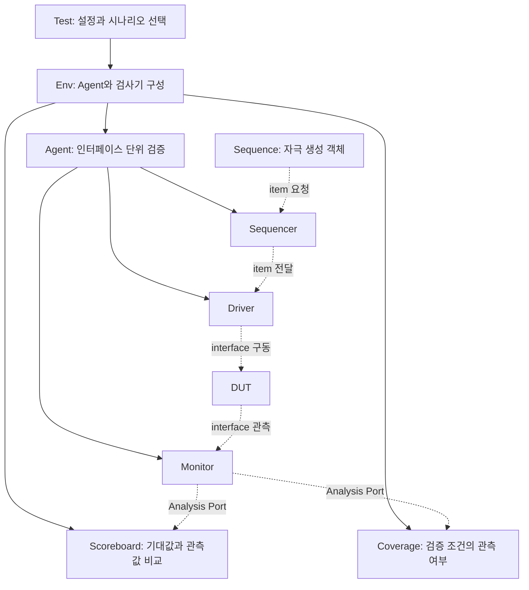
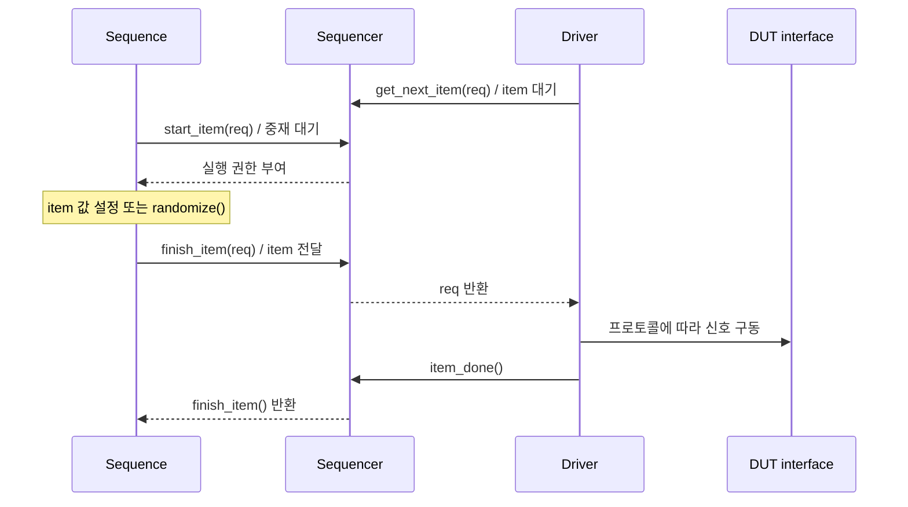

# 🧪 UVM 세미나

## 📝 학습 범위

**Accellera UVM 1.2**를 기준으로 검증 환경의 구조와 transaction의 이동 과정을 정리합니다. 핵심은 자극 생성, 핀 구동, 실제 신호 관측, 결과 검사를 분리하고 라이브러리의 공통 서비스를 이용해 환경을 재사용하는 것입니다.

## 1. OOP와 객체의 역할

| 구분 | 대표 클래스 | 역할 |
| --- | --- | --- |
| 데이터·시나리오 객체 | `uvm_sequence_item`, `uvm_sequence` | 전송 데이터, 제약 조건, 자극의 순서를 표현 |
| 계층 구성 요소 | `uvm_test`, `uvm_env`, `uvm_agent`, `uvm_driver`, `uvm_monitor` | 부모·자식 계층을 만들고 phase에 따라 실행 |

`uvm_component`도 `uvm_object` 계열입니다. 구분 기준은 상속 여부 자체보다 **검증 환경의 계층과 phase에 참여하는가**입니다. Sequence와 item은 component 계층의 노드가 아닙니다.

상속으로 공통 동작을 확장하고, 다형성으로 같은 인터페이스의 다른 구현을 선택합니다. 클래스 handle 대입은 같은 객체를 가리키므로, 독립된 데이터를 보관하려면 `copy()`·`clone()`과 해당 필드의 복사 구현을 확인해야 합니다. [UVM Class Reference — uvm_object](https://verificationacademy.com/verification-methodology-reference/uvm/docs_1.2/html/files/base/uvm_object-svh.html)

## 2. Test → Env → Agent

실선은 component 구성 관계, 점선은 데이터·신호 흐름입니다.

- **Active Agent**: Sequencer·Driver·Monitor를 구성해 자극을 주고 결과를 관측합니다.
- **Passive Agent**: Monitor를 중심으로 외부에서 발생한 전송을 관측합니다.
- **Sequence**: Sequencer에서 실행할 시나리오를 표현합니다. 여러 Agent를 조율하는 상위 시나리오는 Virtual Sequence로 구성할 수 있습니다.

Monitor의 관측값을 검사에 사용하면 Driver가 요청한 데이터와 DUT에서 실제 수락된 전송을 구분할 수 있습니다. [UVM User's Guide — 검증 환경과 Agent 구조](https://www.accellera.org/images/downloads/standards/uvm/uvm_users_guide_1.2.pdf)

## 3. Sequence–Sequencer–Driver handshake

위 그림은 item을 하나씩 처리하는 기본 흐름입니다. `get_next_item()`으로 받은 요청에는 `item_done()`을 한 번 대응시킨 뒤 다음 요청을 가져옵니다. `item_done()`은 Sequencer와 Driver 사이의 처리 완료 통지이며, DUT의 응답 검사 통과를 뜻하지 않습니다. 별도 응답이 필요한 프로토콜에서는 response 전달과 결과 검사를 함께 설계합니다. [UVM User's Guide §3.5.1](https://www.accellera.org/images/downloads/standards/uvm/uvm_users_guide_1.2.pdf#page=42)

## 4. Phase와 시뮬레이션 종료

| 공통 phase | 주요 작업 |
| --- | --- |
| `build_phase` | 설정을 읽고 하위 component 생성 — 위 계층부터 실행 |
| `connect_phase` | 생성된 component의 TLM port·export 연결 — 아래 계층부터 실행 |
| `end_of_elaboration_phase` | 완성된 계층과 연결 확인 |
| `start_of_simulation_phase` | 실행 직전 설정 확인과 초기 보고 |
| `run_phase` | 시간을 소비하는 자극·구동·관측 task 실행 |
| `extract_phase` → `check_phase` → `report_phase` | 누적 결과 정리, 미완료 항목 검사, 결과 보고 |
| `final_phase` | 마지막 정리 |

여러 component의 `run_phase`는 병렬로 실행됩니다. 상세 runtime phase인 reset·configure·main 등의 스케줄은 공통 `run_phase`와 병행하므로 두 체계를 동일한 순차 목록으로 취급하지 않습니다.

`objection`은 task phase를 유지하는 수단입니다. Test에서 objection을 올리고 Sequence 실행 및 필요한 응답 처리를 기다린 뒤 내리는 식으로 종료 책임을 정합니다. Monitor의 무한 루프만으로 phase가 유지되지는 않으며, objection이 모두 해제되어 phase가 끝나면 실행 중인 task도 종료됩니다. [UVM Class Reference — Common Phases](https://verificationacademy.com/verification-methodology-reference/uvm/docs_1.2/html/files/base/uvm_common_phases-svh.html)

## 5. Factory와 configuration

| 서비스 | 목적 | 사용 시 확인할 점 |
| --- | --- | --- |
| Factory | 기반 타입의 생성 요청을 다른 등록 타입으로 대체 | `type_id::create()`를 이용해야 override가 생성 과정에 반영됨 |
| Type override | 해당 타입의 생성 요청에 공통 대체 구현 적용 | 특정 테스트에서 Driver·Sequence 등의 구현 선택 |
| Instance override | 지정한 인스턴스 경로에 대체 구현 적용 | 여러 Agent 중 특정 경로에만 적용할 때 사용 |
| `uvm_config_db#(T)` | 계층 경로와 필드 이름으로 타입이 있는 설정 전달 | `set()`과 `get()`의 타입, scope, key가 일치하는지 확인 |

직접 `new()`를 호출하면 factory의 타입 선택을 거치지 않습니다. 설정은 virtual interface, Agent의 active/passive 모드, 환경별 옵션을 전달하는 데 사용합니다. Factory는 **어떤 구현을 생성할지**, configuration은 **그 인스턴스에 어떤 설정을 줄지**를 담당합니다. [Factory](https://verificationacademy.com/verification-methodology-reference/uvm/docs_1.2/html/files/base/uvm_factory-svh.html) · [Configuration DB](https://verificationacademy.com/verification-methodology-reference/uvm/docs_1.2/html/files/base/uvm_config_db-svh.html)

## 6. Analysis Port와 검사 경로

Monitor는 완료된 관측 transaction을 `analysis_port.write(item)`으로 구독자에게 배포합니다. `write()`는 function이며, 시간 대기나 READY 기반 흐름 제어를 제공하지 않습니다. 구독자는 받은 값을 수정하지 않아야 하며, 객체 handle이 자동으로 깊은 복사되는 것도 아닙니다. [UVM Class Reference — Analysis Port](https://verificationacademy.com/verification-methodology-reference/uvm/docs_1.2/html/files/tlm1/uvm_analysis_port-svh.html)

| 소비자 | 관측값의 사용 |
| --- | --- |
| Scoreboard | 참조 모델의 기대 결과와 실제 전송의 데이터·순서 비교 |
| Coverage | opcode, 경계 조건, 전송 조합 등 검증 목표의 관측 여부 기록 |
| 기록기 | 오류 재현에 필요한 transaction 정보 저장 |

관측 객체를 재사용하거나 나중에 처리한다면 복사본을 큐에 보관하는 등 객체 소유권을 정합니다. 시간이 필요한 검사는 `write()`에서 끝내려 하지 않고 별도 처리 task로 넘깁니다. **Coverage 적중과 기능 검사의 성공은 각각 확인**해야 합니다.

## 📂 참고 문헌과 적용 예제

- Accellera [UVM 1.2 User's Guide](https://www.accellera.org/images/downloads/standards/uvm/uvm_users_guide_1.2.pdf): 검증 환경, Agent, Sequence·Driver 연결.
- Accellera [UVM 1.2 Class Reference](https://www.accellera.org/images/downloads/standards/uvm/UVM_Class_Reference_Manual_1.2.pdf): 클래스와 API의 상세 계약.
- [FIFO UVM 검증](../../../UVM_FIFO/README.md): 단일 Agent와 참조 큐 기반 검사.
- [SPI / I2C Multi-Agent UVM 검증](../../../UVM_SPI_I2C/README.md): 복수 Agent의 조율과 관측 경로 분리.
- [인턴십 기술 세미나 목록](../../README.md)
