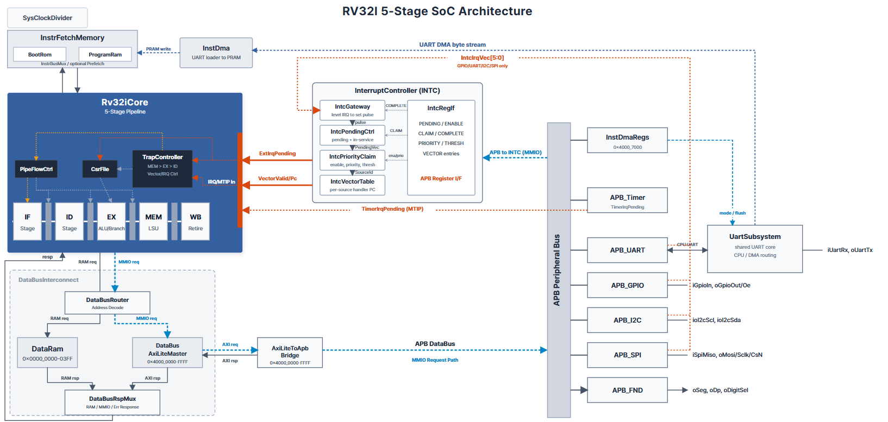

# 🧠 RISC-V RV32I 5-Stage SoC

## 📝 프로젝트 개요

Basys3 FPGA에서 동작하는 **RV32I 5단계 파이프라인 CPU와 주변장치를 직접 설계한 개인 SoC 프로젝트**입니다. 명령어 실행부터 메모리 접근, 버스 변환, 인터럽트 처리, UART 프로그램 다운로드까지 하드웨어와 C 펌웨어를 함께 구성했습니다.

CPU가 Bubble Sort 펌웨어를 실행하면서 UART·GPIO로 명령을 받고, 정렬 과정을 로컬 FND와 SPI·I2C로 연결한 별도 표시용 Slave에 출력합니다.

- **대상 보드**: Basys3 · Artix-7 `xc7a35tcpg236-1`
- **코어**: 32-bit RV32I · IF / ID / EX / MEM / WB · CSR / Trap / Interrupt
- **기본 클럭**: 보드 입력 100 MHz → MMCM 분주 후 시스템 25 MHz
- **기술**: `SystemVerilog` · `Embedded C` · `AXI4-Lite / APB` · `UART / SPI / I2C` · `Vivado / XSim`

## 🔑 주요 구현

| 구성 | 구현 내용 |
|---|---|
| **5단계 CPU** | 명령어 Fetch·Decode·Execute·Memory·Writeback, 단계별 파이프라인 레지스터 |
| **Hazard·Forwarding** | Load-use stall, 연산·저장 데이터 forwarding, 분기·점프·예외에 따른 flush와 PC 전환 |
| **메모리** | BootRom·ProgramRam 명령어 경로와 DataRam 데이터 경로 분리, 직접 읽기·동기 읽기·prefetch 구성 |
| **버스** | CPU 데이터 요청을 AXI4-Lite로 변환하고 APB 주변장치에 연결, byte strobe·대기·오류 응답 처리 |
| **인터럽트·예외** | Machine CSR, trap 진입·복귀, 타이머 인터럽트, 외부 인터럽트 우선순위·claim/complete·벡터 처리 |
| **UART 다운로드** | CPU 통신과 로더의 UART 경로 공유, InstDMA를 통한 ProgramRam 적재 |
| **주변장치** | UART, GPIO, I2C Master, SPI Master, FND, Timer, Interrupt Controller |
| **펌웨어 통합** | UART·GPIO 제어, Bubble Sort 상태 머신, SPI trace 전송, I2C 표시 모드 설정 |

## 🧩 SoC 구조



`TOP`이 CPU·메모리·버스·주변장치를 연결하고, `Rv32iCore`가 파이프라인 실행을 담당합니다. 명령어는 `InstrFetchMemory`를 통해 읽고, 데이터 접근은 `DataBusInterconnect`에서 DataRam과 MMIO로 분기합니다.

MMIO 경로는 `DataBusAxiLiteMaster` → `AxiLiteToApbBridge` → APB 주변장치로 이어집니다. 외부 인터럽트는 `InterruptController`가 취합하고, `TrapController`·`CsrFile`·`PipeFlowCtrl`이 예외 상태와 파이프라인 흐름을 제어합니다.

[CPU 데이터패스](./docs/images/Core.png) · [인터럽트 구조](./docs/images/Interrupt%20Controller.png) · [명령어별 데이터 흐름 SVG](./src/dataflow_svgs)

## 🗺️ 메모리 맵

명령어와 데이터 주소 공간을 분리하며, 주소 정의는 [`soc.yml`](./soc.yml)을 기준으로 RTL·C 헤더·링커 설정에 공유합니다.

| 영역 | 주소 공간 | 시작 주소 | 크기 |
|---|---|---:|---:|
| BootRom | 명령어 | `0x0000_0000` | 4 KiB |
| ProgramRam | 명령어 · InstDMA 쓰기 | `0x0000_1000` | 60 KiB |
| DataRam | 데이터 | `0x0000_0000` | 1 KiB |
| APB MMIO | 데이터 | `0x4000_0000` | 64 KiB |

APB 영역은 4 KiB 단위로 UART·GPIO·I2C·INTC·SPI·FND·Timer·InstDMA 제어 레지스터를 배치했습니다. 각 주변장치 주소는 [메모리 맵](./md/SOC_MEMORY_MAP.md)에 정리되어 있습니다.

## 🔄 Bubble Sort 데모

4개 숫자의 정렬 상태를 CPU 펌웨어가 관리합니다. UART 숫자 입력으로 배열을 구성하고, 비교·교환 결과를 FND에 표시하면서 **24-byte SPI trace**를 표시용 Slave에 전달합니다. Slave는 I2C로 지정한 모드에 따라 pass·compare·swap·total count를 표시합니다.

| 입력 | 동작 |
|---|---|
| UART `0~9` | 배열을 왼쪽으로 이동하고 새 숫자를 오른쪽에 입력 |
| UART `s/S` · GPIO bit 0 | 정렬 시작 |
| UART `p/P` · GPIO bit 1 | 일시정지·재개 |
| UART `n/N` · GPIO bit 2 | 일시정지 상태에서 한 단계 실행 |
| UART `r/R` · GPIO bit 3 | 배열·정렬 상태 초기화 |

예를 들어 `1253s`를 입력하면 배열 `1253`을 정렬해 FND에 `1235`를 표시하고, UART로 `01 02 03 05`를 출력합니다.

펌웨어는 [`sw/apps/hello_world/src/main.c`](./sw/apps/hello_world/src/main.c), 표시용 Slave RTL은 [`companion/SLVAE_BUBBLE/src`](./companion/SLVAE_BUBBLE/src)에 있습니다. 기본 UART 속도는 **115,200 bps**입니다.

## 🧪 검증과 재현

[`tests.json`](./tests.json)에 **15개 회귀 테스트**를 구성했습니다.

| 구분 | 개수 | 검사 내용 |
|---|---:|---|
| 모듈 단위 | 12 | AXI4-Lite Master·APB Bridge, Timer, CSR·Trap, InstDMA 제어·데이터·레지스터, 명령어 Mux, ProgramRam, UART RX/TX Router |
| UART 다운로드 통합 | 1 | UART 패킷 수신과 ProgramRam 적재 |
| Master/Slave 연결 | 1 | SPI trace, I2C 레지스터 접근, 표시 모드·오류 처리 |
| 펌웨어 E2E | 1 | CPU 실행 중 외부 UART·GPIO 입력, 정렬 결과, 버스 전송, FND·Slave 카운터·인터럽트 처리 |

펌웨어 E2E는 **UART 입력·정렬, GPIO 시작, 일시정지·단계 실행·재개, 초기화, I2C 표시 모드**의 5개 시나리오를 검사합니다.

**Windows · Python 3 · Vivado XSim** 환경에서 `RISC_V_SoC` 폴더를 기준으로 실행합니다.

```powershell
.\run_tests.bat --vivado-bin "C:\AMDDesignTools\2025.2\Vivado\bin"
```

개별 테스트는 `--job`으로 선택합니다.

```powershell
.\run_tests.bat --job uart_inst_dma --vivado-bin "C:\AMDDesignTools\2025.2\Vivado\bin"
.\run_tests.bat --job board_preflight --vivado-bin "C:\AMDDesignTools\2025.2\Vivado\bin"
.\run_tests.bat --job bubble_sort_e2e --vivado-bin "C:\AMDDesignTools\2025.2\Vivado\bin"
```

실행기는 [`tools/run_xsim.py`](../tools/run_xsim.py)를 사용합니다. 테스트 입력인 [`sw/prebuilt/bubble_sort_demo.mem`](./sw/prebuilt/bubble_sort_demo.mem)을 포함하며, 실행 결과는 `results/`, 임시 빌드는 `.sim_build/`에 생성됩니다.

## 🛠️ 펌웨어·개발 도구

- **펌웨어 빌드**: RV32I/Zicsr·ILP32 C 프로그램을 ELF·BIN·MEM 이미지로 변환합니다. RISC-V GCC는 PATH 또는 `RISCV_GCC` 환경 변수에서 찾습니다.
- **UART 로더**: 명령행·GUI에서 로더 패킷 생성과 프로그램 다운로드를 수행합니다.
- **SoC 설정 생성**: `soc.yml`에서 RTL 주소 상수, C 메모리 헤더, 링커 메모리 영역과 주소표를 생성합니다.
- **명령어 메모리 비교**: LUT ROM·동기 BRAM·prefetch 구성을 바꿔 용량별 시뮬레이션과 Vivado 자원·타이밍을 비교합니다.

명령별 사용법은 [개발 도구 안내](./tools/README.md), 메모리 실험 구성은 [Instruction Memory Sweep](./tools/timing/instr_mem_sweep/README.md)에 정리되어 있습니다.

## 📂 코드와 자료

- **[💻 RTL](./src)** · **[🧪 테스트벤치](./tb)** · **[⚙️ 테스트 구성](./tests.json)**
- **[📦 C 펌웨어·부트 코드](./sw)** · **[🔗 표시용 Slave](./companion/SLVAE_BUBBLE/src)**
- **[🛠️ 빌드·UART·메모리 실험 도구](./tools)** · **[📍 Basys3 핀 제약](./constrs/basys3_top.xdc)**
- **[🗺️ 메모리 맵](./md/SOC_MEMORY_MAP.md)** · **[🖼️ SoC·CPU·FSM 구조도](./docs/images)**
