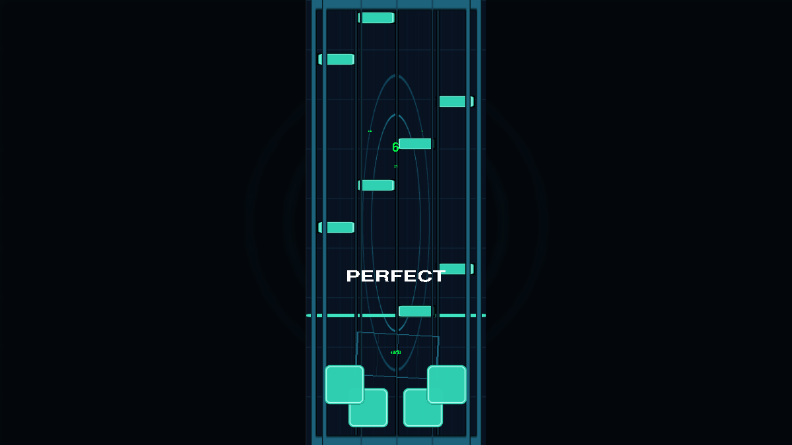

# 🎮 터치식 리듬게임

## 📅 프로젝트 정보

- **수행**: 2024.04 ~ 2024.05
- **기술**: `Python` · `pygame-ce` · `Pillow`
- **플레이 방식**: 4개 레인 · 키보드 D / F / J / K

## 📝 프로젝트 개요

음악의 박자에 맞춰 내려오는 노트를 입력하고, 타이밍에 따라 점수와 콤보를 쌓는 **4레인 리듬게임**입니다. 곡 선택 화면에서 게임을 시작하면 채보의 BPM과 시간 정보에 맞춰 노트를 생성하고, 입력 시점과 노트의 도착 시간을 비교해 판정합니다.

`pygame-ce`로 화면·입력·오디오를 처리하고, `Pillow`로 배경의 흐림 효과와 밝기를 조절합니다. 기본 데모는 코드로 생성한 음원·그래픽·채보와 기본 폰트를 사용합니다.

## ✅ 주요 기능

- **4레인 입력**: D / F / J / K 키에 대응하는 노트 생성과 입력 효과
- **타이밍 판정**: PERFECT · GREAT · GOOD · BAD · WORST · MISS
- **점수·콤보**: 판정 등급별 점수와 연속 입력 콤보 표시
- **Fever 효과**: 게이지 누적, 최대 5단계 배율과 화면 효과
- **곡 선택**: 방향키로 곡을 선택하고 Space로 시작
- **기본 데모**: 120 BPM, 32개 노트와 자체 생성 음원·그래픽

## 🕹️ 조작 방법

| 키 | 동작 |
| :---: | :--- |
| ↑ / ↓ | 곡 선택 |
| Space | 선택한 곡 시작 |
| D / F / J / K | 왼쪽부터 각 레인의 노트 입력 |
| Esc | 게임 중 곡 선택 화면으로 돌아가기 |
| Alt + F4 | 게임 종료 |



## 📂 코드와 실행

| 파일 | 내용 |
| :--- | :--- |
| [main.py](./Source_Code/main.py) | 곡 선택, 채보 로딩, 노트·판정·점수·콤보·Fever 처리 |
| [demo_assets.py](./Source_Code/demo_assets.py) | 기본 폰트, 기하학 그래픽, 데모 음원과 채보 생성 |
| [requirements.txt](./Source_Code/requirements.txt) | Python 패키지 의존성 |

Python 3.13 환경에서 저장소 루트를 기준으로 실행합니다.

```powershell
cd Touch_Rhythm_Game\Source_Code
python -m venv .venv
.\.venv\Scripts\python.exe -m pip install -r requirements.txt
.\.venv\Scripts\python.exe main.py
```

화면·오디오 장치 없이 실행하는 자동 검증 명령입니다.

```powershell
.\.venv\Scripts\python.exe main.py --headless --smoke-test
```

자동 검증은 곡 선택과 키 입력을 수행하며, 300개 게임 프레임 동안 노트 로드·점수 증가·음원 재생 시작을 검사합니다.

`Source_Code` 아래의 `font`, `img`, `song`, `note` 경로에 게임이 참조하는 파일을 배치하면 해당 자산을 우선 사용합니다. 파일이 없는 항목은 기본 데모 자산으로 실행됩니다.
