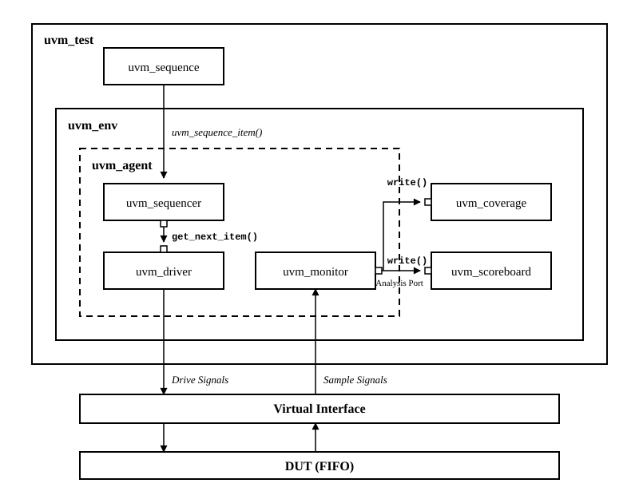

# 🧪 FIFO UVM 검증

## 📝 프로젝트 개요

**4-bit × 8-entry 동기 FIFO**를 UVM으로 검증한 개인 프로젝트입니다. 경계 조건을 직접 구동하는 시나리오와 제약 기반 랜덤 시퀀스를 구성하고, 실제로 수락된 쓰기·읽기를 큐 기반 참조 모델과 비교합니다.

`SystemVerilog` · `UVM 1.2` · `SVA`를 사용하며, Driver·Monitor·Scoreboard·Coverage를 분리해 입력 생성부터 데이터·상태 검증까지 연결했습니다.

## ⚙️ FIFO 동작과 검증 구조

| 항목 | 구성 |
| :--- | :--- |
| 데이터 폭·깊이 | 4-bit · 8-entry |
| 클록 | 단일 클록, 테스트벤치 주기 10 ns |
| 리셋 | Active-low 비동기 리셋 |
| 쓰기 수락 | `Wr_En && !Full` |
| 읽기 수락 | `Rd_En && !Empty` |
| 읽기 출력 | 클록 에지에서 갱신되는 등록 출력 |

쓰기와 읽기가 동시에 요청되면 에지에서의 FIFO 상태에 따라 처리합니다.

| 요청 시 상태 | 수락되는 동작 | 저장 개수 변화 |
| :--- | :--- | :---: |
| Empty | 쓰기 | +1 |
| 데이터 1~7개 | 쓰기·읽기 | 0 |
| Full | 읽기 | −1 |



| 구성 요소 | 기능 |
| :--- | :--- |
| `FifoItem` · `FifoSeq` | 쓰기·읽기 명령, 데이터, 유휴 사이클 생성 |
| `FifoAgent` | Sequencer·Driver·Monitor 구성과 TLM 연결 |
| `FifoDriver` | Virtual Interface를 통해 명령과 데이터 구동 |
| `FifoMonitor` | 명령·수락 상태와 등록 출력·갱신 후 상태 수집 |
| `FifoScoreboard` | 참조 큐와 읽기 순서·데이터·Full/Empty 비교 |
| `FifoCoverage` | 명령 종류·수락 여부·저장량·데이터 및 명령×저장량 조합 수집 |
| `FifoAssertions` | 상태 신호의 X/Z, Full/Empty 동시 활성화, 읽기 출력의 X/Z 검사 |

Monitor는 클록 에지에서 명령과 갱신 전 `Full/Empty`를 샘플링하고, 1 ns 뒤 등록 출력과 갱신 후 상태를 수집합니다. Scoreboard는 수락된 읽기를 참조 큐에서 꺼내 비교한 뒤 수락된 쓰기를 추가하고, 다음 상태의 플래그까지 검증합니다.

## ✅ 주요 구현과 검증

| 시나리오 | 검증 내용 |
| :--- | :--- |
| Fill / Drain | FIFO를 가득 채우고 순서대로 읽어 데이터와 플래그 비교 |
| Overflow | Full 상태의 추가 쓰기 차단 |
| Underflow | Empty 상태의 추가 읽기 차단 |
| 동시 Read / Write | 같은 사이클의 입출력과 저장 개수 변화 |
| 랜덤 명령 | 쓰기·읽기·동시 요청·유휴 명령 200개, 명령 사이 0~2개 유휴 사이클 |
| 종료 Drain | 남은 데이터를 모두 읽고 참조 큐가 빈 상태로 종료 |

랜덤 명령의 가중치는 **쓰기 / 읽기 / 동시 요청 / 유휴 = 35 / 35 / 20 / 10**입니다. 각 실행은 경계 시나리오, 랜덤 명령, 종료 Drain 순서로 진행합니다.

**Vivado XSim · UVM 1.2 회귀 결과**

| 랜덤 seed | 검증한 클록 사이클 | 수락된 쓰기 / 읽기 | 종료 시 참조 큐 |
| :---: | ---: | ---: | ---: |
| 1 | 659 | 110 / 110 | 0 |
| 17 | 666 | 110 / 110 | 0 |
| 2026 | 657 | 117 / 117 | 0 |

총 **1,982사이클**, **337개 읽기 데이터**를 비교했으며, 세 실행 모두 **UVM_ERROR 0 · UVM_FATAL 0**으로 통과했습니다.

## 🔧 실행 방법

Python 3과 Vivado XSim 환경에서 저장소 루트를 기준으로 실행합니다.

```powershell
python tools/run_xsim.py UVM_FIFO/tests.json --vivado-bin "C:\AMDDesignTools\2025.2\Vivado\bin"
```

[tests.json](./tests.json)에 정의된 seed 3개를 실행하며, 결과 요약과 로그는 `UVM_FIFO/results/`에 생성됩니다.

VCS 환경에서는 Bash 실행 스크립트를 사용합니다.

```bash
bash UVM_FIFO/tb/run_vcs.sh
```

VCS 스크립트는 UVM 1.2로 `FifoTest`를 빌드·실행하고 `output/vcs/`에 결과를 생성합니다. `EXTRA_SIM_OPTS="+WAVES"`로 VCD 파형 출력을 활성화할 수 있습니다.

## 📂 코드와 자료

| 경로 | 내용 |
| :--- | :--- |
| [src/Top.sv](./src/Top.sv) | 동기 FIFO RTL |
| [tb](./tb) | UVM Agent·시퀀스·Scoreboard·Coverage |
| [tb/FifoIf.sv](./tb/FifoIf.sv) | Virtual Interface와 Clocking Block |
| [tb/fifo_assertions.sv](./tb/fifo_assertions.sv) | FIFO 상태·출력 SVA |
| [tb/run_vcs.sh](./tb/run_vcs.sh) | VCS 빌드·실행 스크립트 |
| [docs/images/uvm-testbench-architecture.svg](./docs/images/uvm-testbench-architecture.svg) | 테스트벤치 구조도 |
