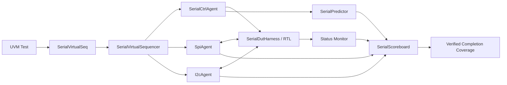

# SPI / I2C UVM Multi-Agent Verification

SystemVerilog로 작성한 Serial Master·Slave RTL을 **SerialCtrlAgent, SpiAgent, I2cAgent**로 검증하는 UVM 1.2 프로젝트입니다. Virtual Sequence가 제어 설정과 독립 버스 시퀀스를 조율하며, Scoreboard는 입력 의도·실제 핀 전송·LED 반영을 차례로 비교합니다.

정식 소스는 `src/`와 `tb/` 한 벌입니다. 기존 단일 에이전트 코드의 별도 개선 버전 디렉터리는 두지 않습니다. 기존 보고서와 이미지는 원본 바이트를 보존해 과거 결과로 구분합니다.

## 검증 결과 (2026-10-15)

**20/20 회귀 통과**, 정상 테스트에서 SPI 106개·I2C 99개 전송을 검증했습니다. 별도 negative 테스트는 오염·누락·중복 진단 3개와 정상 재개를 확인했습니다. 모든 실행의 pending은 0이며, 독립 버스 병렬 테스트에서 5쌍의 실제 시간 구간 중첩을 확인했습니다.

[검증 결과와 테스트별 로그](results/2026-10-15_multi_agent/README.md) · [Native Coverage HTML](results/2026-10-15_multi_agent/coverage/functionalCoverageReport/dashboard.html)

SPI·I2C 각각 9개의 지원 RW×payload cross bin을 모두 관측했습니다. 새 3개 covergroup의 병합 도달률은 100%이며, 정의한 모델의 범위로 해석합니다. 기존 보고서·이미지 21개와 원본 소스 51개의 SHA-256 일치도 확인했습니다.

## 구성과 검증 대상

| Topology | RTL 구성 | SPI Agent | I2C Agent | 검증 목적 |
| --- | --- | --- | --- | --- |
| `LOOPBACK` | Master + Slave 1쌍 | Passive | Passive | 자동 polling의 write/read, 프로토콜 전환, 양쪽 LED |
| `SPI_SLAVE_UNIT` | SPI 전용 Slave | Active master BFM | Passive | SPI mode 0 프레임과 register 동작 |
| `I2C_SLAVE_UNIT` | I2C 전용 Slave | Passive | Active master BFM | 7-bit 주소, ACK/NACK, repeated START, register 동작 |
| `DUAL_SLAVE_UNIT` | SPI Slave + I2C Slave, **서로 다른 두 인스턴스** | Active master BFM | Active master BFM | 두 버스 전송 구간의 실제 중첩과 데이터 독립성 |

SerialCtrlAgent는 모든 구성에서 reset·switch 설정을 담당합니다. 기존 Slave의 프로토콜 선택 구조를 유지하므로, 병렬 검증은 독립 Slave 두 개를 대상으로 합니다.



## 실행

검증 환경은 **Vivado Simulator 2025.2 / 내장 UVM 1.2 / Python 3**입니다. `xvlog`, `xelab`, `xsim`이 PATH에 있으면 프로젝트 루트에서 실행합니다.

```powershell
python sim/run_regression.py
python sim/run_regression.py --test SerialSmokeTest
python sim/run_regression.py --test SerialDualBusParallelTest
python sim/run_regression.py --test SerialResetRecoveryTest --topology DUAL_SLAVE_UNIT
python sim/run_regression.py --test SerialRandTest --seed 2026
python sim/audit_sources.py
```

설치 경로를 직접 지정할 수도 있습니다.

```powershell
python sim/run_regression.py --vivado-bin 'C:/AMDDesignTools/2025.2/Vivado/bin'
```

`sim/run_vcs.sh`는 별도 VCS adapter이며 셸 구문만 확인했습니다. 실제 회귀 결과는 XSim 실행에서 얻었습니다.

실행기는 `sim/tests.json`의 12개 테스트 클래스를 topology·seed별 **20개 job**으로 실행합니다. 정적 `TbTop.P_TOPOLOGY`와 테스트의 허용 구성이 다르면 시작 시 실패합니다. 테스트 이름은 `run_test()`에 고정하지 않고 `UVM_TESTNAME`으로 전달합니다.

결과는 `results/<실행 시각>/summary.json`과 테스트별 로그에 저장됩니다. 요약에는 simulator·seed·소스 SHA-256·완료/중단/미처리 수·예상 진단 수·coverage hit mask를 기록합니다. 종료 코드만 확인하지 않고 UVM_ERROR/FATAL, HDL assertion 오류, 완료 건수, pending queue까지 검사합니다. 빌드 캐시는 `sim/.build/`에 있으며 Git에서 제외합니다.

## 주요 개선

- **실제 버스 Monitor:** SPI의 CS/SCLK/MOSI/MISO, I2C의 START/STOP·바이트·ACK를 복원합니다. LED 값이 그대로인 반복 전송도 별도 완료로 셉니다.
- **독립 예측:** register `0x01` write의 하위 7bit LED 반영, register `0x02` read의 switch 값을 입력 계약으로 예측합니다. DUT readback을 기대값으로 사용하지 않습니다.
- **순서·reset 분리:** endpoint, reset epoch, configuration ID, wire 순서로 비교합니다. 자동 polling의 write→read 순서를 검사하며 reset으로 중단된 전송은 따로 집계합니다.
- **구동 소유권:** Passive Agent에는 Driver·Sequencer가 없습니다. I2C BFM은 LOW/high-Z만 구동하고 풀업과 resolved bus는 정적 interface에 둡니다.
- **검증된 완료 Coverage:** Scoreboard를 통과한 전송만 성공 coverage에 반영합니다. 요청 수, 중단 수, 주소 NACK, 오류 주입 결과는 따로 해석합니다.
- **검증기 자체 검증:** 관측값 오염·누락·중복에 대해 정확히 세 개의 예상 진단을 확인하며, 그 밖의 오류는 그대로 실패 처리합니다.

## 자료 안내

- [현재 구조와 책임](docs/architecture.md)
- [지원 프로토콜 계약과 범위](docs/protocol_contract.md)
- [테스트 매핑과 판정 기준](docs/verification_plan.md)
- [원본 파일 및 보존 산출물 해시](docs/source_provenance.json)
- [기존 2026-04-20 리포트](results/historical_2026-04-20/index.html)

기존 리포트의 18/18 functional point, 33 matched transaction, 100% 표기는 당시 환경의 결과입니다. 새 멀티에이전트 환경의 coverage 분모와 전송 집계 단위는 다릅니다. `docs/images/`의 기존 캡처도 과거 결과입니다.

`src/boards/master/TOP.sv`와 `src/boards/slave/TOP.sv`는 보드 wrapper 이름을 유지합니다. 시뮬레이션은 `SerialMasterCore`·`SerialSlaveCore`를 직접 사용하며 두 `TOP`을 한 filelist에 함께 넣지 않습니다. 이번 검증의 대상은 RTL/UVM 시뮬레이션이며 보드 구현·배선·전기적 타이밍 인증은 포함하지 않습니다.
