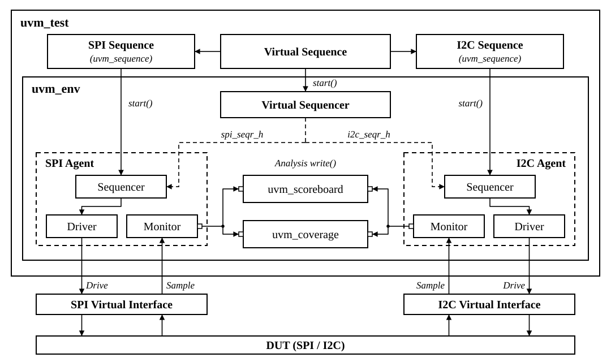

# 🔌 SPI / I2C Multi-Agent UVM 검증

## 📅 프로젝트 정보

- **프로젝트 형태**: 개인 프로젝트
- **기술 스택**: `SystemVerilog` · `UVM 1.2` · `SVA` · `Python`
- **시뮬레이터**: `Vivado Simulator 2025.2`
- **검증 구성**: 제어·SPI·I2C Agent, Virtual Sequence, 4개 Topology

## 📝 프로젝트 개요

SPI·I2C Master/Slave RTL의 데이터 정합성과 프로토콜 동작을 검증하는 **멀티에이전트 UVM 환경**입니다. 제어 Agent와 두 프로토콜 Agent를 분리하고, Virtual Sequence로 루프백·단위 검증·병렬 전송을 조율합니다.

각 프로토콜의 Monitor가 실제 핀 신호에서 프레임을 복원하고, Scoreboard가 요청·응답·레지스터·LED 상태를 비교합니다. 검증을 통과한 완료 전송을 Coverage에 전달해 입력 생성부터 결과 비교까지 연결했습니다.

## 🔑 멀티에이전트 구성

| 구성 요소 | 기능 |
| :--- | :--- |
| `SerialCtrlAgent` | 리셋·프로토콜 선택·스위치 데이터 설정과 LED 상태 관측 |
| `SpiAgent` | SPI Mode 0 핀 구동과 프레임 복원, Active / Passive 전환 |
| `I2cAgent` | Open-drain 버스 구동, START·STOP·ACK/NACK·데이터 복원 |
| `SerialVirtualSequencer` | 활성 Sequencer와 시나리오 설정·완료 동기화 연결 |
| `SerialVirtualSeq` | 순차 전송·프로토콜 전환·병렬 실행·리셋 복구 시나리오 조율 |
| `SerialPredictor` | 제어 요청과 레지스터 규칙으로 기대값 생성 |
| `SerialScoreboard` | 프로토콜별 요청 큐, 버스 관측값, 응답·LED 상태 비교 |
| `SpiCoverage` · `I2cCoverage` · `SerialCoverage` | 검증 완료 전송의 payload·RW·프로토콜 조합과 병렬 구간 수집 |

`serial_ctrl_uvm_pkg`, `spi_uvm_pkg`, `i2c_uvm_pkg`는 공통 타입 패키지를 기반으로 독립적으로 구성했습니다. `SerialEnv`가 Agent와 Scoreboard·Coverage를 연결하며, Passive Agent는 Monitor만 생성합니다.

## 📐 검증 구조



SPI·I2C Agent를 중심으로 직접 작성한 구조도입니다. 이 프로젝트에서는 `SerialCtrlAgent`와 `SerialPredictor`로 제어·상태 검증을 구성하고, Coverage에는 Scoreboard 검증을 통과한 전송을 전달합니다.

- **전송 식별**: 프로토콜별 요청 큐와 endpoint·리셋 세대·설정 정보를 기준으로 관측 프레임을 비교합니다.
- **완료 판정**: 복원된 버스 프레임과 데이터 검증을 거친 뒤 레지스터·LED 반영 상태를 검사합니다.
- **병렬 실행**: 독립 Slave 두 개에 SPI·I2C 시퀀스를 `fork...join`으로 실행하고 실제 프레임 시간 구간의 중첩을 계산합니다.
- **리셋 복구**: 진행 중 프레임을 중단 처리하고, 리셋 세대를 갱신한 뒤 새 전송의 완료와 대기 큐를 검사합니다.

## 📊 검증 구성과 시나리오

| Topology | RTL 구성 | SPI Agent | I2C Agent |
| :--- | :--- | :---: | :---: |
| `LOOPBACK` · 0 | Master + Slave 1쌍 | Passive | Passive |
| `SPI_SLAVE_UNIT` · 1 | SPI 전용 Slave | Active | Passive |
| `I2C_SLAVE_UNIT` · 2 | I2C 전용 Slave | Passive | Active |
| `DUAL_SLAVE_UNIT` · 3 | 독립 SPI Slave + I2C Slave | Active | Active |

제어 Agent는 모든 구성에서 활성화됩니다. Active 프로토콜 Agent는 Master BFM으로 Slave를 구동하며, Loopback 구성에서는 RTL Master가 전송을 시작합니다.

| 테스트 클래스 | 검증 내용 |
| :--- | :--- |
| `SerialSmokeTest` | SPI·I2C 기본 쓰기·읽기 |
| `SerialSpiSmokeTest` · `SerialI2cSmokeTest` | 프로토콜별 루프백 전송 |
| `SerialProtocolSwitchTest` | SPI→I2C 및 I2C→SPI 전환 |
| `SerialRandTest` | 랜덤 설정 16개, seed 1·17·2026 |
| `SerialCoverageClosureTest` | 프로토콜별 payload 경계값과 쓰기·읽기 조합 |
| `SpiSlaveUnitTest` | Active BFM, 상위 비트 쓰기와 레지스터 주소 처리 |
| `I2cSlaveUnitTest` | Repeated START, ACK/NACK, 장치·레지스터 주소 처리 |
| `SerialDualBusParallelTest` | 독립 버스 동시 전송과 물리적 시간 구간 중첩 |
| `SerialRepeatedPayloadTest` | 네 구성에서 동일 payload의 연속 전송을 개별 완료로 검증 |
| `SerialResetRecoveryTest` | 네 구성에서 전송 중 리셋과 이후 전송 복구 |
| `SerialScoreboardNegativeTest` | 관측값 오염·누락·중복을 주입해 검출기 동작 검증 |

## 📄 프로토콜과 레지스터

| 항목 | 동작 |
| :--- | :--- |
| 시스템 클록·리셋 | 100 MHz · Active-high 비동기 리셋 |
| SPI | Mode 0, MSB-first, CS Low 구간당 16-bit 전송 |
| SPI 프레임 | `{read, register_address[6:0]}` + 8-bit 쓰기 또는 dummy 데이터 |
| SPI 읽기 | 마지막 8개 MISO 비트를 SCLK 상승 에지에서 수신 |
| I2C 장치 주소 | 7-bit `0x5A` |
| I2C 쓰기 | START → 주소+W → 레지스터 → 데이터 → STOP |
| I2C 읽기 | START → 주소+W → 레지스터 → Repeated START → 주소+R → 데이터 → NACK → STOP |
| I2C 신호 구동 | LOW / High-Z 출력과 pull-up을 사용하는 Open-drain 구성 |
| 주소 불일치 | NACK 응답, 레지스터 상태 유지 |
| 레지스터 `0x01` 쓰기 | `write_data[6:0]`를 LED에 반영 |
| 레지스터 `0x02` 읽기 | `{1'b0, slave_switch[6:0]}` 반환 |
| 기타 레지스터 접근 | `0x02` 이외 읽기 0 반환, `0x01` 이외 쓰기 시 LED 상태 유지 |
| Master 동작 | `0x01` 쓰기 후 `0x02` 읽기, 완료 후 LED 갱신 |

## ✅ 핵심 성과

| 전체 회귀 | 정상 테스트의 전송 검증 | 예상 외 오류 |
| :---: | :---: | :---: |
| **20 / 20 PASS** | **205건** | **0건** |

- **정상 테스트 19회**: SPI 106건·I2C 99건 완료, UVM_ERROR·UVM_FATAL·HDL assertion 오류 0건
- **Coverage**: 지원하는 RW×payload 조합에서 SPI·I2C 각각 **9 / 9 달성**
- **병렬 검증**: SPI 4건·I2C 4건 완료, 실제 프레임 구간 **5쌍 중첩**
- **리셋 복구**: 네 구성에서 진행 중 프레임 총 6개 중단 후 정상 전송 복구
- **검출기 자체 검증 1회**: 오염·누락·중복을 각 1회 검출하고 정상 전송 3건 완료
- **종료 상태**: 모든 실행의 대기 요청 **0건**

Payload Coverage는 쓰기 값 `0`, `1`, `2~126`, `127`, `128~255`와 읽기 값 `0`, `1`, `2~126`, `127`을 대상으로 합니다. Scoreboard를 통과한 `0x01` 쓰기와 `0x02` 읽기만 해당 조합에 반영합니다.

## 🔧 실행 방법

Python 3과 Vivado Simulator 환경에서 저장소 루트를 기준으로 실행합니다.

```powershell
python UVM_SPI_I2C/sim/run_regression.py --vivado-bin "C:\AMDDesignTools\2025.2\Vivado\bin"
```

실행기는 [sim/tests.json](./sim/tests.json)의 12개 테스트 클래스를 Topology·seed별로 20회 실행합니다. UVM/HDL 오류, 검증 완료 건수, 대기 큐와 시나리오별 조건을 판정하고 `results/`에 결과를 저장합니다. `--output`으로 새 결과 폴더를 지정할 수 있습니다.

| 옵션 | 용도 |
| :--- | :--- |
| `--test SerialDualBusParallelTest` | 지정한 테스트 클래스 실행 |
| `--topology DUAL_SLAVE_UNIT` | 선택한 Topology로 범위 지정 |
| `--seed 17` | 랜덤 seed 지정 |
| `--waves` | VCD 파형 출력 |

소스 구성 검사는 독립 Agent 패키지의 의존성, 컴파일 입력과 HDL 명명 규칙을 점검합니다. 구성 검사는 전체 회귀에서 생성한 스냅샷을 사용해 Topology 불일치 거부 동작을 검증하고, 두 보드 wrapper를 각각 컴파일·elaboration합니다.

```powershell
python UVM_SPI_I2C/sim/audit_sources.py
python UVM_SPI_I2C/sim/check_guards.py --output UVM_SPI_I2C/results/guards --vivado-bin "C:\AMDDesignTools\2025.2\Vivado\bin"
```

VCS 환경에서는 Topology 번호, 테스트 클래스, seed를 지정합니다.

```bash
bash UVM_SPI_I2C/sim/run_vcs.sh 3 SerialDualBusParallelTest 1
```

## 📂 코드 구성

| 경로 | 내용 |
| :--- | :--- |
| [src/common](./src/common) | 프로토콜 상수와 레지스터 주소 |
| [src/master](./src/master) · [src/slave](./src/slave) | Master/Slave Core와 SPI·I2C 서브시스템 |
| [src/boards](./src/boards) | Master·Slave 보드별 TOP wrapper |
| [tb/agents](./tb/agents) | 제어·SPI·I2C별 Item·Driver·Monitor·Agent |
| [tb/env](./tb/env) · [tb/sequences](./tb/sequences) | 통합 환경, Virtual Sequencer와 시나리오 |
| [tb/scoreboard](./tb/scoreboard) | Predictor·Scoreboard·오류 주입 Filter |
| [tb/coverage](./tb/coverage) · [tb/sva](./tb/sva) | 프로토콜별 Coverage와 신호 규칙 검사 |
| [tb/tests](./tb/tests) | 테스트 클래스와 공통 설정 |
| [sim](./sim) | 컴파일 filelist, 회귀·소스·구성 검사 도구 |
