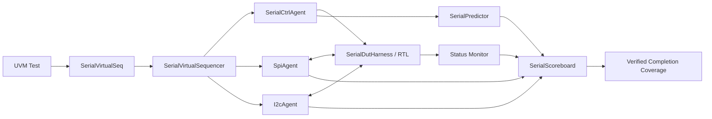

# Verification architecture

## Static and UVM boundaries

`TbTop` separates clock generation, the initial reset request, watchdog, waveform setup, and UVM bootstrap. `SerialDutHarness` elaborates exactly one of four topologies. Its selected parameter is injected into the test; configuration mismatches terminate before stimulus.

The control, status, SPI, and I2C interfaces have clocking blocks and driver/monitor modports. Drivers change pins at the falling system-clock edge. Monitors sample at the rising edge with `input #1step`. Serial edges are decoded from these pin samples; each serial half-cycle is at least 20 system-clock cycles in the tested setup.

The reset interface serializes initial and UVM reset requests through `sema_reset`. Only its `applyReset()` service assigns reset and advances the reset epoch. Configuration changes occur at a complete Master polling-pair boundary, using read-only `oBusy` and `oCmdLoad` outputs; there is no force/release of DUT state.

## Components

| Component | Responsibility |
| --- | --- |
| `SerialCtrlAgent` | Applied control intents and independent sampled LED/reset status |
| `SpiAgent` | Mode-0 SPI monitor; optional active master sequencer/driver |
| `I2cAgent` | Open-drain I2C monitor; optional active master sequencer/driver |
| `SerialVirtualSequencer` | Handles to the active sequencers, scenario configuration and completion barrier |
| `SerialVirtualSeq` | Sequential switch/payload tests, fork/join independent bus tests, reset and checker tests |
| `SerialPredictor` | Immutable copies of control intents and register-map read expectations |
| `SerialScoreboard` | Typed FIFO consumption, ordered request matching, response/LED checks and completion accounting |
| `SpiCoverage`, `I2cCoverage` | Acknowledged register-transfer payload/RW coverage from verified completions |
| `SerialCoverage` | Verified protocol/RW combinations, overlap, switch directions and reset counters |
| `SerialObservationFilter` | Normally clone/pass-through; deliberate corrupt/drop/duplicate only in the checker test |

The SPI and I2C packages depend on common TB types and UVM, not the environment or each other. Passive agents instantiate a monitor only. The environment validates that a passive agent has neither a driver nor a sequencer.

## Correlation and completion

No testbench ID travels on the physical bus. Active-mode requests enter separate protocol FIFOs before their drivers start. A completed wire observation consumes exactly one request in the same endpoint/epoch/configuration. Unknown extra completions and missing requests are errors.

In loopback, one control setting can produce multiple automatic polling pairs. The predictor therefore validates each observed write/read against the setting active at frame start. The Scoreboard enforces alternating write/read order instead of equating one control request with one bus frame.

After wire verification, a bounded 16-system-cycle allowance covers DUT input synchronization and register/LED commit. The status stream is sampled independently. A stable LED value alone never completes a request: a distinct decoded wire frame is mandatory first. The read response is checked against switch intent before it can be compared with the Master's LED mirror.

A reset advances the epoch, clears modeled state and pending active requests, and causes monitors to publish partial frames as aborted. Reset-aborted expectations and observations have separate counters. Tests require recovered verified traffic and empty queues before dropping their objection.

## Parallel topology

`DUAL_SLAVE_UNIT` has two independent `SerialSlaveCore` instances. Endpoint 0 uses fixed SPI selection; endpoint 1 uses fixed I2C selection. Their switch payloads and expected LED values differ. SPI and I2C sequences run under `fork...join`.

Overlap is measured from verified physical frame intervals: `a.start < b.end && a.end > b.start`. Merely starting two sequences at the same simulation time is insufficient. `WIRE_VERIFIED` log entries include endpoints, epoch, configuration and start/end timestamps for inspection.

The mutual-exclusion system assertion applies only to a single-DUT topology. Pin-known, mode-0 idle clock and passive-driver checks remain active in the dual-DUT topology.

## Style and RTL packaging

New TB classes use role suffixes, camelCase handles, `vif_` interfaces, explicit method argument directions, named constraints/coverpoints/assertions and separated simulation-control blocks. RTL uses functional PascalCase interconnect names, `State`/`State_d`, local `state_e` types, named module connections and `[MODULE_INFO_START]` documentation.

The common package contains protocol constants. Controller-local state enums use unprefixed state names without colliding in a shared package. Core extraction retains the board pin contract; board wrappers keep module name `TOP`. The expression `!{RxShift[6:0], iMosiSync}[7]` is represented portably as the identical `!RxShift[6]` header bit. Functional protocol algorithms were retained.
